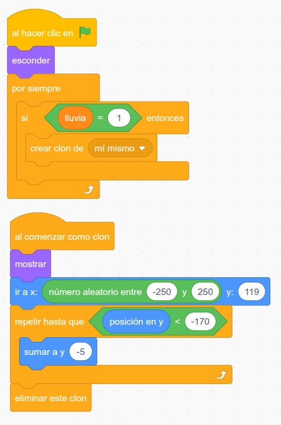

En este proyecto os proponemos construir un tendedero automático que recoge la ropa cuando empieza a llover. Es una adaptación de una idea que se ha visto en numerosas publicaciones en redes, aunque no hemos logrado descubrir cuál fue el proyecto original.

El funcionamiento es sencillo: un [sensor de humedad](/ecosistema/echidnablack2/complementos/sensor-humedad/) conectado a la entrada A2 de la EchidnaBlack2 detecta el agua. Cuando su lectura baja de 685, el [servomotor](/ecosistema/echidnablack2/complementos/servomotor-posicion/) conectado a D7 gira a 90º y mete el tendedero bajo el tejadillo. Cuando la lectura vuelve a superar 715, el servomotor gira a 150º y saca de nuevo la ropa. Para usar la entrada A2, el selector de la placa tiene que estar en [modo sensores](/ecosistema/echidnablack2/modo-sensores-mkmk/).

¿Por qué usamos dos valores distintos? Si usáramos solo uno, cuando la lectura estuviera justo en el límite el tendedero entraría y saldría sin parar. Dejando un pequeño margen entre ambos, el tendedero solo se mueve cuando realmente ha empezado o ha dejado de llover.

Como posibilidad de ampliación, os proponemos llevar la lluvia también a la pantalla de EchidnaML: cuando el sensor detecta agua, cambia el fondo del escenario y empiezan a caer gotas. Así conectamos el modelo físico con su representación virtual.

Como ya es costumbre, hemos preparado una [guía de construcción](https://github.com/EchidnaEducacion/Bricks/blob/main/Tendedero/tendedero.pdf) para que podáis reproducir el modelo paso a paso.

Y también os dejamos un vídeo en el que podéis ver el tendedero en funcionamiento:

[Tendedero automático con Echidna](https://youtu.be/askY4YvSLC0)

Este es el programa principal. La primera parte mueve el tendedero según la lectura del sensor de humedad; la segunda es la de la ampliación: cambia el fondo del escenario y da a la variable *lluvia* el valor 1 si llueve o 0 si no llueve.

Y este es el programa de las gotas, que las hace caer en pantalla cuando la variable *lluvia* está a 1. Se crean clones de la gota que aparecen en la parte superior de la pantalla y bajan hasta desaparecer al llegar a la parte inferior.

Y aquí tenéis el [archivo .sb3](https://github.com/EchidnaEducacion/Bricks/blob/main/Tendedero/tendedero.sb3) con la programación.

Por último, os recordamos que estamos deseando saber qué estáis haciendo con vuestras echidnas. Si os apetece contárnoslo… ¡[poneos en contacto con nosotros](/contacta/)!
