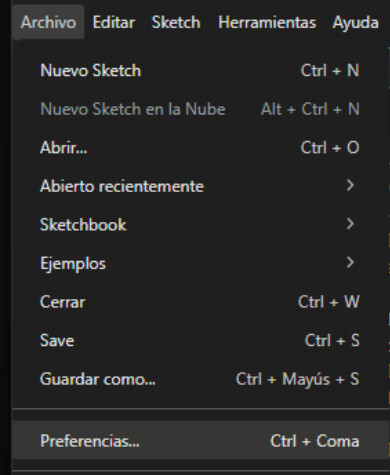
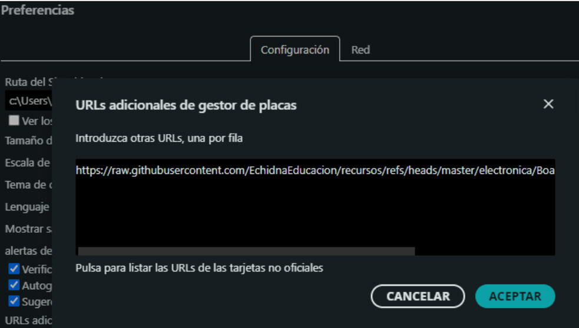
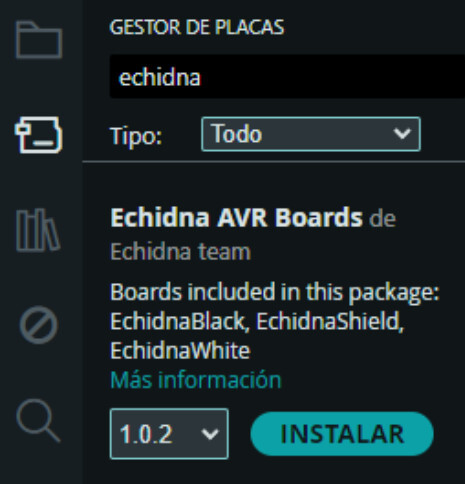
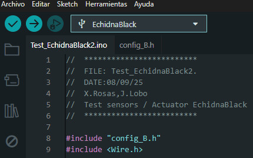

Instalaremos las placas Echidna (**EchidnaShield**, **EchidnaWhite** y **EchidnaBlack/2**) como placas reconocidas formalmente en el IDE de Arduino.

Aunque las placas Echidna son 100% compatibles con las tarjetas estándar del ecosistema Arduino (como Arduino Uno o Arduino Nano), de hecho las diseñamos para que así fuera, resulta mucho más cómodo y reduce los errores en el aula o taller ver directamente el nombre exacto de la placa que estás utilizando dentro del menú de selección del IDE de Arduino.

## Pasos para instalar las placas Echidna

1. **Añadir la URL del gestor de tarjetas adicionales:**

   Abre el IDE de Arduino y dirígete a **Archivo > Preferencias** (o *Arduino IDE > Settings* en macOS).

En el campo **Gestor de URLs Adicionales de Tarjetas**, añade el enlace del archivo JSON oficial ubicado en el repositorio de Echidna:

[https://raw.githubusercontent.com/EchidnaEducacion/recursos/master/electronica/Boards_Arduino/package_echidna_index.json](https://raw.githubusercontent.com/EchidnaEducacion/recursos/master/electronica/Boards_Arduino/package_echidna_index.json)

(Si ya tienes otras URLs escritas en esa casilla, puedes añadir esta separándola con una coma o un Intro).

Aceptaremos, y ya podremos instalar las placas en el gestor de placas

**Resultado:**

Créditos:

El código json se ha refactorizado usando IA.
