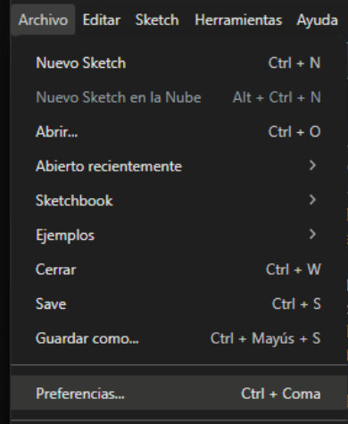
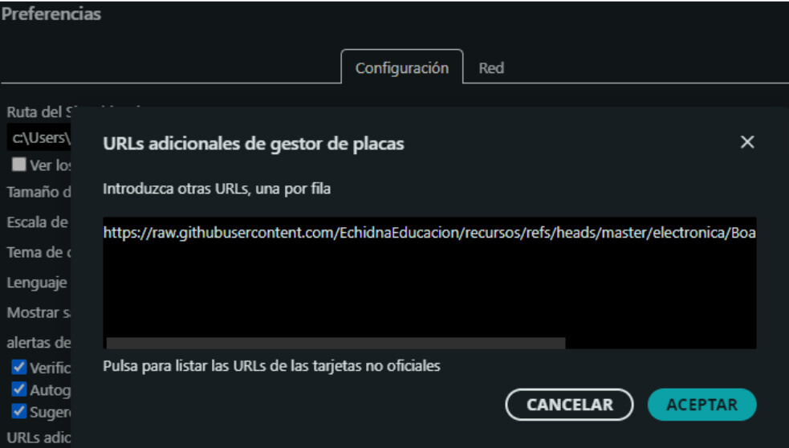
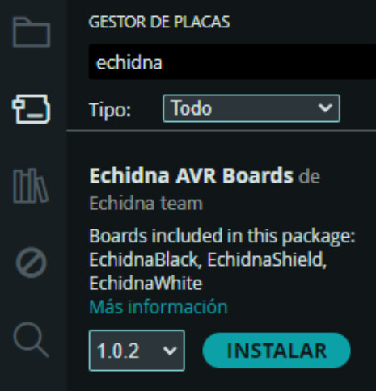
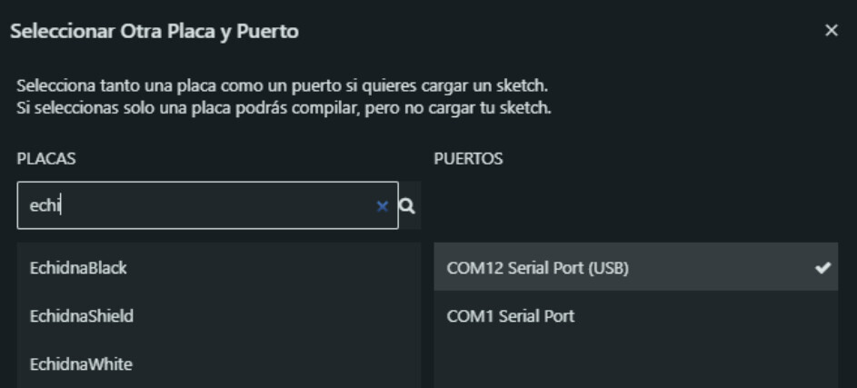
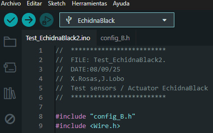

Instalaremos las placas Echidna (**EchidnaShield**, **EchidnaWhite** y **EchidnaBlack** o **EchidnaBlack2**) como placas reconocidas formalmente en el IDE de Arduino.

Aunque las placas Echidna son 100% compatibles con los modelos estándar del ecosistema (como Arduino Uno o Arduino Nano) —de hecho, las diseñamos para que así fuera—, seleccionarlas por su propio nombre ofrece una gran ventaja. En el aula o el taller, ver directamente la placa exacta que estás usando en el menú del IDE resulta mucho más cómodo y evita errores.

## Pasos para instalar las placas Echidna

1. **Añadir la URL del gestor de tarjetas adicionales:**

   Abre el IDE de Arduino y dirígete a **Archivo > Preferencias** (o *Arduino IDE > Settings* en macOS).

En el campo **Gestor de URLs Adicionales de Tarjetas**, añade el enlace del archivo JSON oficial ubicado en el repositorio de Echidna:

[https://raw.githubusercontent.com/EchidnaEducacion/recursos/master/electronica/Boards_Arduino/package_echidna_index.json](https://raw.githubusercontent.com/EchidnaEducacion/recursos/master/electronica/Boards_Arduino/package_echidna_index.json)

(Si ya tienes otras URLs escritas en esa casilla, puedes añadir esta, separándola con una coma o un Intro).

Acepta, ya puedes instalar las placas en el gestor de placas.

**Resultado:** Seleccionar otra placa y puerto

Créditos:

El código JSON se ha refactorizado usando IA.
