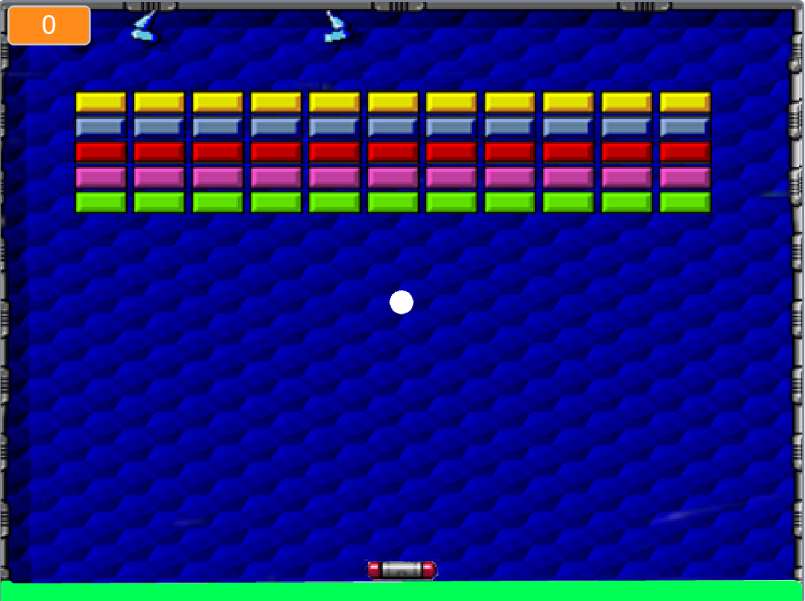
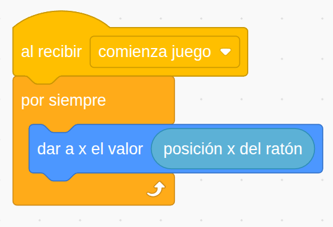
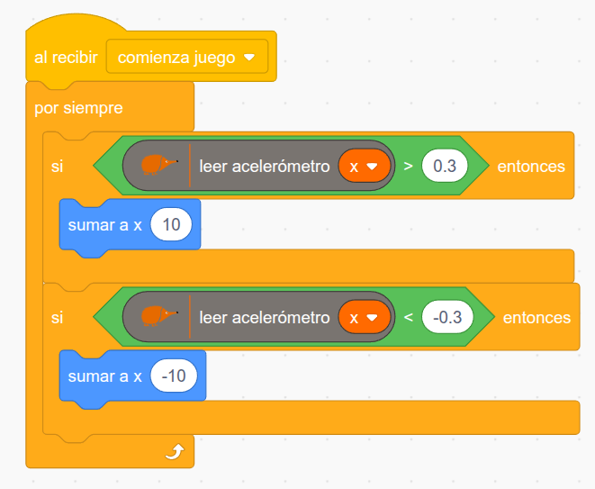

Uno de los grandes potenciales de la placa **EchidnaBlack2** y del entorno **[EchidnaML](/ecosistema/echidnaml/)** es que nos permite reutilizar cualquier proyecto ya creado en Scratch y enriquecerlo con interactividad física, usando los sensores y las entradas de la placa. Echidna nos permite relacionar el mundo digital de los ordenadores con el mundo físico real.

## ¿Qué conseguimos con este tipo de proyectos?

- **Desarrollar la creatividad**: ¡nos convertimos en diseñadores y diseñadoras de nuestros propios mandos de videojuegos!
- **Reutilizar y remezclar**: aprovechamos la enorme comunidad de Scratch y el trabajo de otros creadores para aprender y construir sobre lo que ya existe, gracias a los principios del software libre.
- **Aprender a analizar código**: para cambiar el control del juego, primero tenemos que entender cómo está programado por dentro. Analizar y entender el código de otras personas es una habilidad muy útil, que nos permite trabajar en equipo y aprender de los demás.

## Los 7 pasos para adaptarlo

Convertir un juego de Scratch que se maneja con el teclado o el ratón en un juego interactivo con herramientas libres es muy sencillo:

1. **Selecciona** un videojuego de Scratch que te guste.
2. **Analiza** cómo interactúa el usuario con el programa (¿usa las flechas, la barra espaciadora, el ratón…?).
3. **Diseña** la nueva interacción física con los sensores de Echidna.
4. **Descarga** el proyecto (`.sb3`) desde la web de Scratch a tu ordenador: *Archivo → Guardar en tu ordenador*.
5. **Carga** el archivo en EchidnaML: *Archivo → Cargar desde tu ordenador*.
6. **Modifica** los bloques de control para vincularlos a Echidna.
7. **¡A jugar!**

## Ejemplo práctico: Arkanoid con control por inclinación

Vamos a ver paso a paso cómo transformar el clásico videojuego [Arkanoid](https://scratch.mit.edu/projects/124343120/).

### 1. Análisis del juego original

Al abrir el proyecto en Scratch («Ver dentro») y revisar el código de los diferentes objetos, vemos que en el objeto **Nave** el movimiento horizontal está vinculado a la posición horizontal del ratón mediante este bloque:

### 2. Rediseño del mando con Echidna

En lugar del ratón, vamos a mover la nave inclinando la placa EchidnaBlack2, gracias a su [acelerómetro integrado](/ecosistema/echidnablack2/acelerometro/).

Como se explica en su ficha, en el eje X el acelerómetro da valores en torno a 0 en reposo, que se acercan a −1 al inclinar la placa hacia la izquierda y a 1 al inclinarla hacia la derecha.

### 3. Cambiando la interacción en EchidnaML

1. Abrimos EchidnaML y cargamos el proyecto descargado de Scratch.
2. [Conectamos la placa](/ecosistema/echidnaml/conectar-placa/) EchidnaBlack2.
3. Sustituimos el bloque *dar a x el valor posición x del ratón* por dos condicionales que, según el valor del acelerómetro en el eje X, aumentan o disminuyen la posición x de la Nave:

### 4. ¡Resultado!

Al inclinar la placa hacia la izquierda o hacia la derecha, la nave del Arkanoid se desplaza siguiendo nuestros movimientos en tiempo real.

<!-- Pendiente: GIF animado del juego en marcha, en web/public/2026/11/hackeando-videojuegos-de-scratch-con-echidna-arkanoid/ -->

## Retos para el aula

- ¿Se te ocurre cómo usar un pulsador de la placa para lanzar la bola al empezar la partida?
- ¿Puedes encender el LED rojo cuando perdamos una vida? ¿O hacer que suene el zumbador?
- ¿Cómo podemos hacer que el movimiento de la Nave sea proporcional a la inclinación de la placa?
- ¿Se te ocurre otro tipo de interacción para manejar el juego con la placa?

¡Experimenta y [comparte tu proyecto](/contacta/) con la comunidad!

## Créditos

El juego de Scratch está hecho a partir de las instrucciones de [Programo Ergo Sum](https://www.programoergosum.es/).
