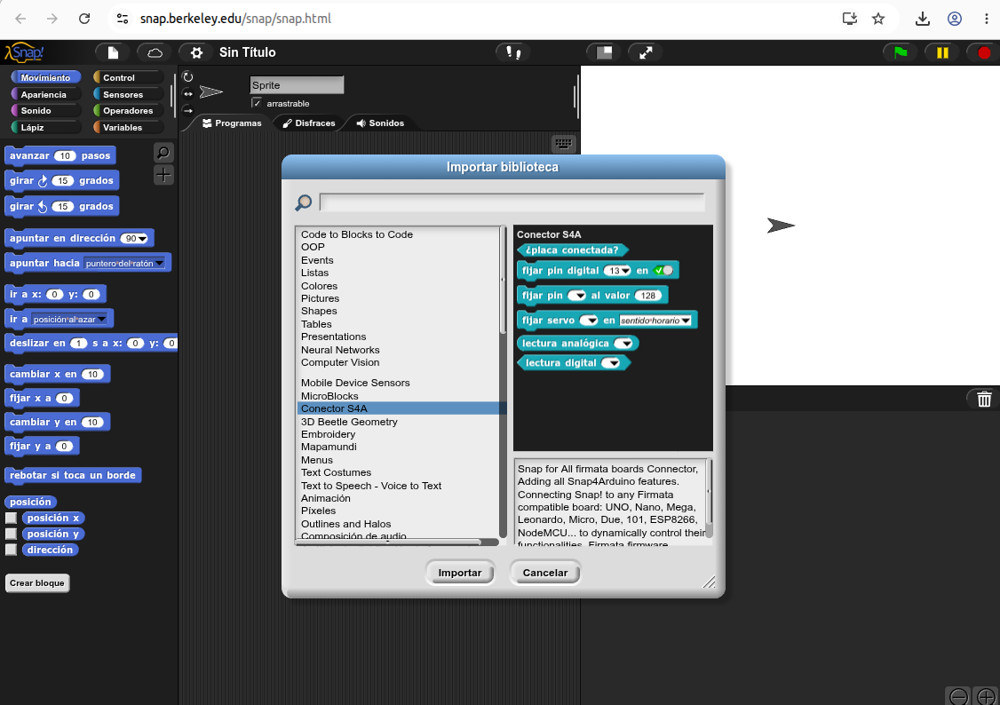
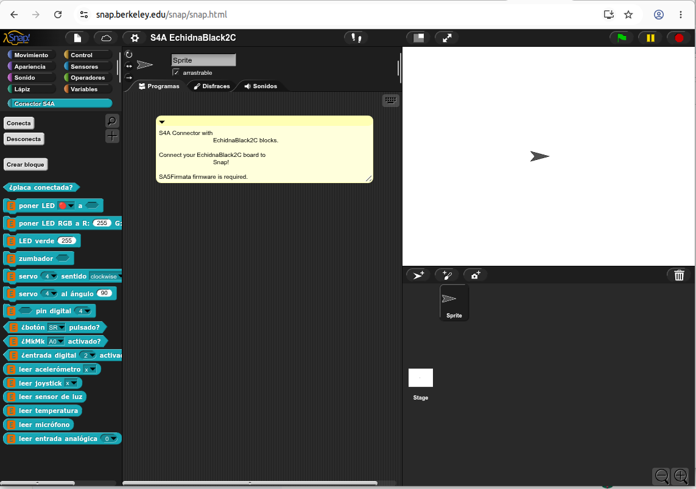

**Snap!** es un entorno de programación visual por bloques, potente y versátil, desarrollado por la Universidad de Berkeley (California). Aunque se parece a Scratch, está pensado para explorar conceptos avanzados de informática de una forma más profunda y rigurosa.

En el ecosistema Echidna, Snap! es la herramienta ideal para el alumnado de **Secundaria y Bachillerato** que ha superado las limitaciones de Scratch y busca más control sobre la placa y los datos.

## Características

- **Libre y en línea**: es software libre y gratuito, y se usa directamente desde el navegador, en [snap.berkeley.edu](https://snap.berkeley.edu/), sin instalar nada.
- **Un lenguaje completo**: permite crear bloques propios, usar recursividad y trabajar con estructuras de datos complejas.
- **Un entorno sobrio**: su interfaz es menos colorida que la de Scratch y deja un espacio de trabajo despejado para proyectos complejos.
- **Para profundizar**: está orientado a quienes quieren avanzar en la lógica de programación y en la ciencia de la computación.
- **Bibliotecas para Echidna**: Snap! permite añadir bibliotecas con bloques para trabajar con la placa.

## Cómo empezar

Snap! funciona en el navegador: entra en [snap.berkeley.edu](https://snap.berkeley.edu/) y pulsa **Run Snap! Now**, que abre el editor. Si creas una cuenta, puedes guardar tus proyectos en línea.

Para conectar Snap! con la placa necesitas:

1. **Chrome o Chromium**, porque son los navegadores que pueden comunicarse con la placa por el USB.
2. **La placa con StandardFirmata**, el programa que trae de fábrica, y conectada al ordenador con el cable USB. Si has cargado otro programa con el Arduino IDE, [vuelve a instalar StandardFirmata](/ecosistema/echidnaml/instalar-standardfirmata/).
3. **Que el navegador detecte el puerto USB** de la placa.

### Conector S4A

La conexión con la placa la hace la biblioteca **Conector S4A**, que viene con Snap!:

1. En el menú **Archivo** (el icono de la hoja), elige **Bibliotecas…**.
2. Selecciona **Conector S4A** y pulsa **Importar**.
3. En la categoría Conector S4A, pulsa **Conecta** y elige el puerto de la placa en el cuadro que abre el navegador.
4. Comprueba la conexión con el bloque **¿placa conectada?**.

Con el Conector S4A se programa la placa con bloques genéricos de Arduino, indicando el número de pin.

### Biblioteca Echidna

Además de los bloques genéricos, Echidna tiene su propia biblioteca, con bloques adaptados a las entradas y salidas de la **EchidnaBlack2**: los LED, el LED RGB, el zumbador, los servos, los pulsadores, las entradas MkMk, el acelerómetro, el joystick y los sensores de luz, temperatura y sonido. **Está en modo pruebas**.

1. Descarga el fichero [`S4A-EchidnaBlack2C.xml`](https://github.com/EchidnaEducacion/S4A-EchidnaBlack2C/blob/main/S4A-EchidnaBlack2C.xml) desde su repositorio de GitHub (con el botón de descarga).
2. En Snap!, en el menú **Archivo**, elige **Abrir…** y luego **Computadora**.
3. Busca el fichero en tu ordenador y ábrelo.

Los bloques de Echidna aparecen en la categoría Conector S4A, debajo de **Conecta** y **Desconecta**.

## Materiales en preparación

Estamos terminando de probar la Biblioteca Echidna y preparando una guía para empezar a usar Snap! en el aula. Puedes seguir el desarrollo de la biblioteca en su [repositorio de GitHub](https://github.com/EchidnaEducacion/S4A-EchidnaBlack2C).
